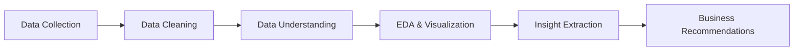

# 🍽️ Zomato Data Analysis Project

**Restaurant Sales & Customer Behavior Analysis using Python**


> **Author:** Subhadip Koley · B.Tech CSE (AI/ML), Brainware University, Kolkata

---

## 📌 Table of Contents
1. [Overview](#-overview)
2. [Business Problem](#-business-problem)
3. [Dataset](#-dataset)
4. [Tech Stack](#-tech-stack)
5. [Project Workflow](#-project-workflow)
6. [Analysis & Key Findings](#-analysis--key-findings)
7. [Business Recommendations](#-business-recommendations)
8. [Project Structure](#-project-structure)
9. [How to Run](#-how-to-run)
10. [Troubleshooting](#-troubleshooting)
11. [Limitations & Future Scope](#-limitations--future-scope)
12. [Author](#-author)

---

## 🔎 Overview

Zomato is a major online food-ordering and restaurant-discovery platform. This project performs **Exploratory Data Analysis (EDA)** on Zomato restaurant data to understand what customers order from, how restaurants are rated, how much couples spend, and how online vs offline ordering affects ratings.

## 💼 Business Problem

Zomato wants to understand customer preferences to improve partnerships, pricing insights and marketing offers. This project answers six business questions:

| # | Question | Visualization |
|---|----------|---------------|
| 1 | What type of restaurant do the majority of customers order from? | Count plot |
| 2 | How many votes has each type of restaurant received? | Line plot |
| 3 | What ratings have the majority of restaurants received? | Histogram |
| 4 | What is the average spending for couples ordering online? | Histogram |
| 5 | Which mode (online or offline) has received the maximum rating? | Box plot |
| 6 | Which restaurant type gets more offline orders (for retention offers)? | Heatmap |

*Problem statements are based on the iScale "Data Analysis Project Using Python" (Zomato) tutorial.*

## 📂 Dataset

File: `Zomato data .csv` (one row per restaurant listing)

| Column | Description |
|--------|-------------|
| `online_order` | Whether the restaurant accepts online orders (Yes/No) |
| `rate` | Customer rating (stored as text like `4.1/5`, converted to float) |
| `votes` | Number of customer votes |
| `approx_cost(for two people)` | Approximate meal cost for two |
| `listed_in(type)` | Restaurant category (Dining, Cafes, Buffet, Other…) |

Data quality: **no null values, no duplicate rows.**

## 🛠️ Tech Stack

- **Python 3**
- **Pandas** – data loading, cleaning, GroupBy, pivot tables
- **NumPy** – numerical operations
- **Matplotlib** & **Seaborn** – visualization
- **Jupyter Notebook** – interactive analysis

## 🔄 Project Workflow



1. **Data Collection** – load the CSV with `pd.read_csv()`.
2. **Data Cleaning** – convert `rate` from text (`4.1/5`) to float.
3. **Data Understanding** – check dtypes, nulls and duplicates.
4. **EDA & Visualization** – answer each business question with a suitable chart.
5. **Insight Extraction** – note the finding for each chart.
6. **Recommendations** – convert findings into actions for Zomato.

Rating cleaning step:

```python
def rate(value):
    value = str(value).split("/")
    return float(value[0])

df["rate"] = df["rate"].apply(rate)
```

## 📊 Analysis & Key Findings

| Question | Finding |
|----------|---------|
| Most popular type | **Dining** restaurants dominate |
| Votes | Dining > Other > Cafes > Buffet |
| Ratings | Most restaurants are rated **3.4 – 3.8** |
| Spending | Average cost for two is a little over **400** |
| Ordering mode | Restaurants accepting **online orders have higher average ratings** |
| Offline orders | **Dining** restaurants have the most offline orders |

> Exact numbers are printed in the notebook outputs.

## 💡 Business Recommendations

- **Target Dining customers** with loyalty and retention offers.
- **Encourage restaurants to enable online ordering** – it is associated with higher ratings.
- **Design price-aware promotions** around the ~400 average spend for two.
- **Support low-rated restaurants**, since most ratings cluster between 3.4 and 3.8.

## 🗂️ Project Structure

```
zomato-data-analysis/
├── Zomato_analysis.ipynb                 # Main analysis notebook
├── Zomato data .csv                      # Dataset
├── requirements.txt                      # Python dependencies
├── docs/
│   └── Zomato_Project_Documentation.pdf  # Full project documentation
└── README.md
```

## ▶️ How to Run

```bash
# 1. Clone the repository
git clone https://github.com/koleysubhadip42-netizen/zomato-data-analysis.git
cd zomato-data-analysis

# 2. (Optional) create a virtual environment
python -m venv venv
venv\Scripts\activate        # Windows
# source venv/bin/activate   # macOS / Linux

# 3. Install dependencies
pip install -r requirements.txt

# 4. Launch Jupyter and open the notebook
jupyter notebook Zomato_analysis.ipynb
```

Make sure the CSV file is in the same folder as the notebook.

## 🧰 Troubleshooting

**`AttributeError: module 'pandas' has no attribute 'Series'`**
A file named `pandas.py` in your working folder is shadowing the real library. Rename or delete it (and any `__pycache__` folder next to it), then restart the kernel.

## 🚧 Limitations & Future Scope

**Limitations**
- Descriptive analysis only – shows patterns, not causes.
- Single snapshot of data, so no time trends.

## 👤 Author

**Subhadip Koley**
B.Tech CSE (AI/ML) – Brainware University, Kolkata


⭐ If you found this project useful, consider giving it a star!
